# 茶里茶里 iPad 点单收银 App（ChaliPOS）

按《茶里茶里 一体化点单收银系统 设计思路》做的 iPad 原生 App（SwiftUI）。
点单 → 规格 → 购物车 → 结账 → 出杯标签都在同一个 App 里完成，断网也能点单、收现金。

对应设计文档里的 **第 0 期 Demo** 全部内容，加上 **第 1 期里不需要联网的部分**（现金结账、楽天收款后点「已收款」、外卖手动录入、售罄、日结、报表、报税 CSV、老板权限），
以及 **扫码点单**：顾客扫码用手机点单、到柜台付款，iPad 接单出杯贴，做好后顾客手机显示可取餐（需要联网，用 Supabase，见 [QROrder/README.md](QROrder/README.md)）。
订单云同步、钱箱、菜单屏网页、支付自动联动还没做，见文末「下一步」。

## 截图

在 iPad 模拟器里用示例订单截取（`screenshots/`，由 GitHub Actions 生成）：

| 点单 | 规格弹层 |
|---|---|
| 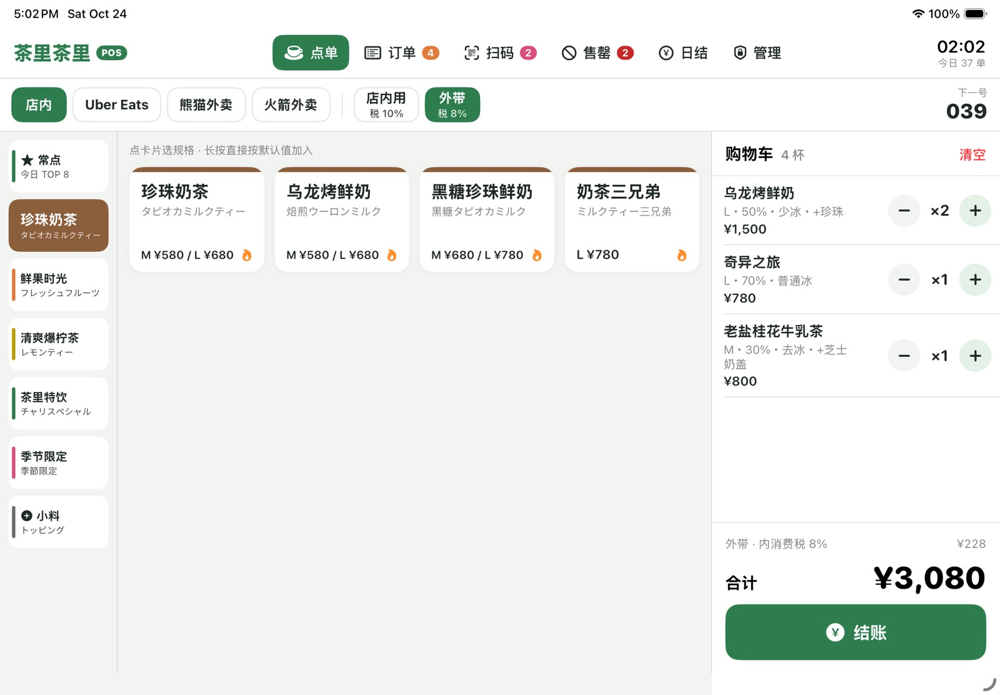 | 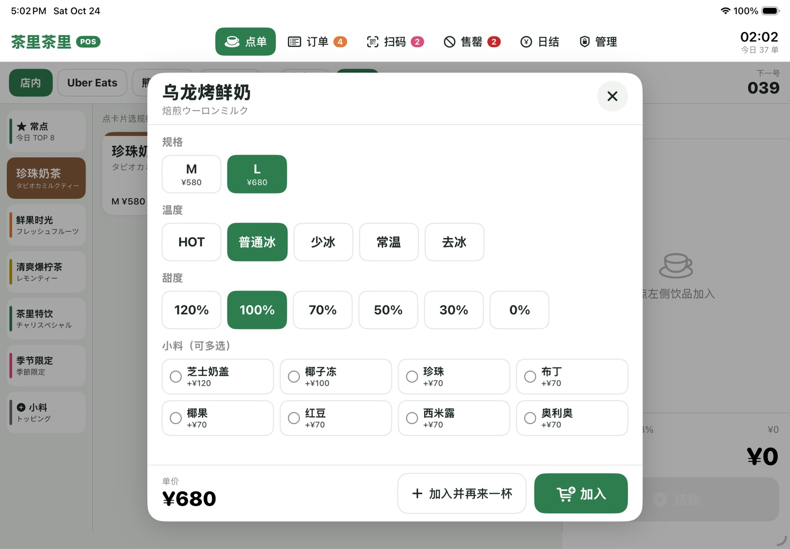 |
| **现金结账** | **订单 / 出杯标签** |
| 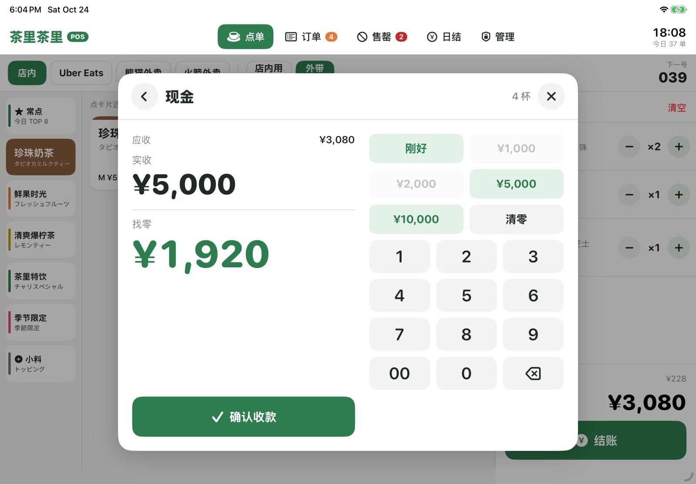 | 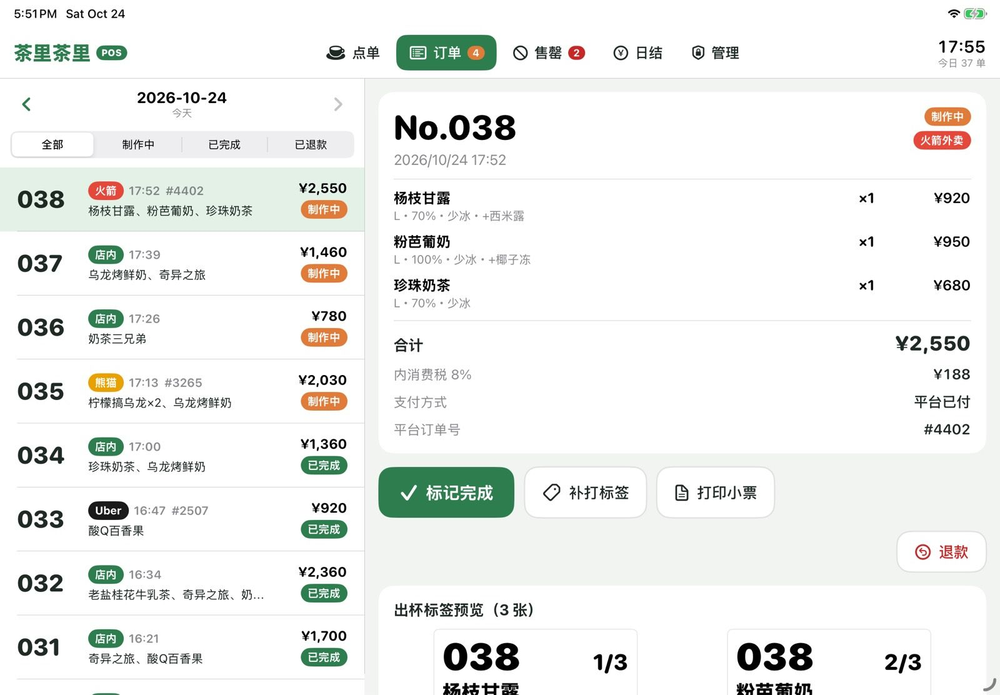 |
| **扫码单（接单 / 叫号）** | **扫码点单二维码海报** |
| 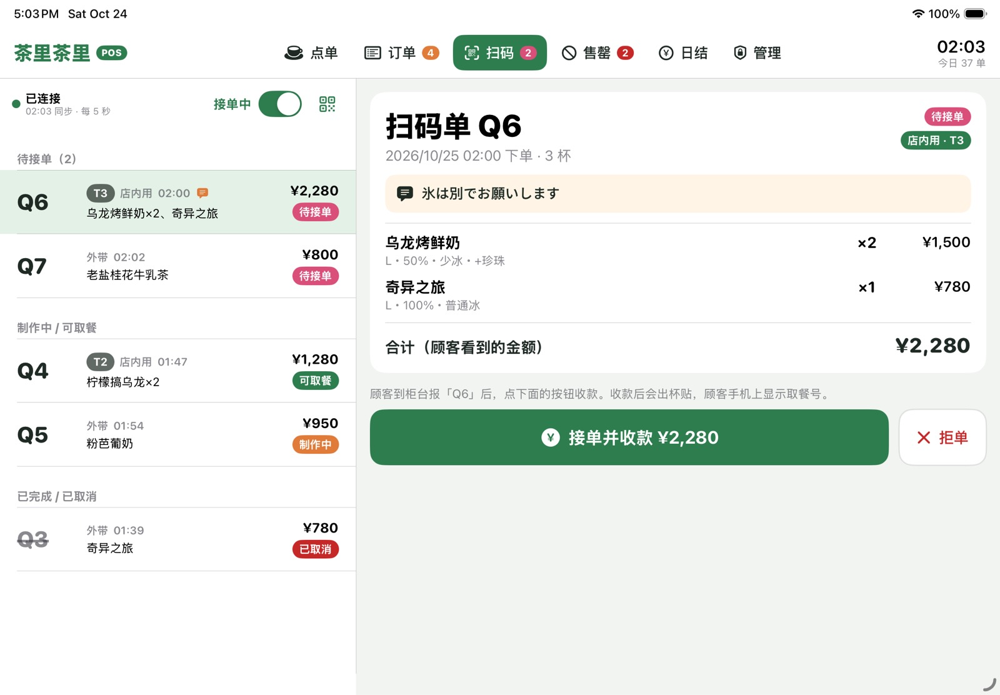 | 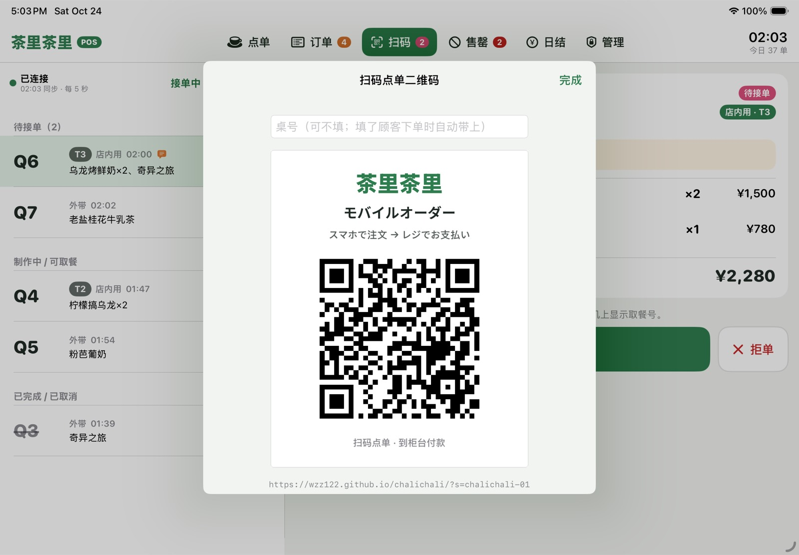 |
| **售罄管理** | **日结** |
| 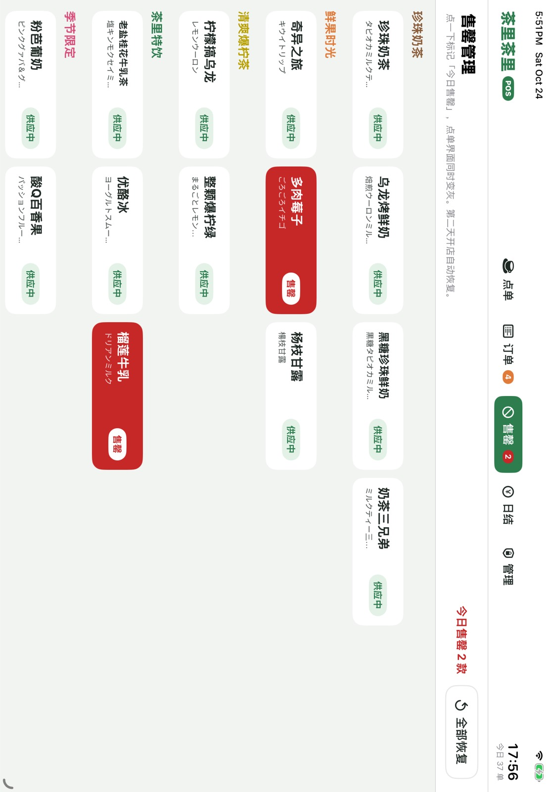 | 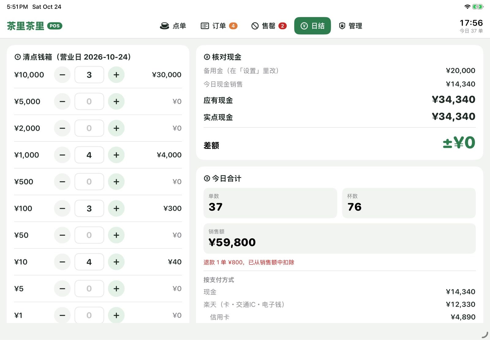 |
| **报表（老板）** | **菜单编辑（老板）** |
| 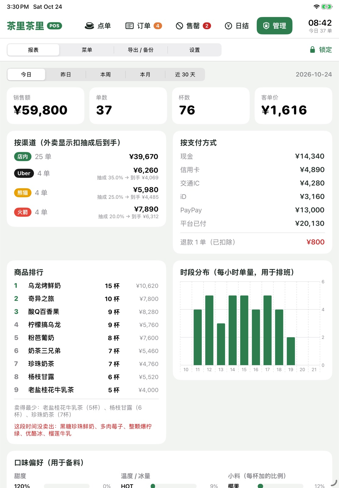 | 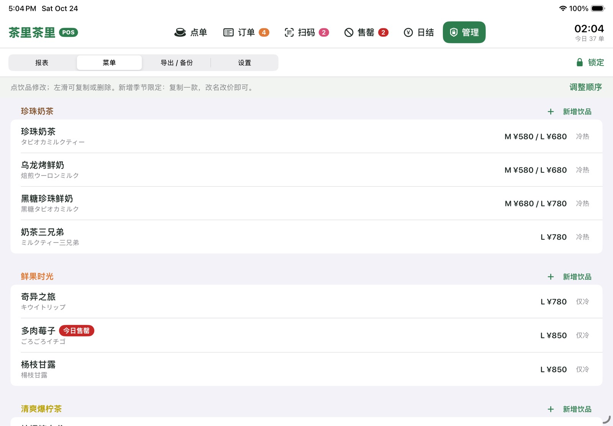 |

## 装到 iPad 上

`ChaliPOS.swiftpm` 是一个 App 包，iPad 上的 Swift Playgrounds 和 Mac 上的 Xcode 都能直接打开。

### 方法 A：只用 iPad（Swift Playgrounds，免费）

1. 在 iPad 上安装 App Store 的「Swift Playgrounds」（4.4 及以上）。
2. 把整个 `ChaliPOS.swiftpm` 文件夹放进 iPad 的「文件」App（iCloud Drive，或从 Mac AirDrop 过去）。
3. 在「文件」里点 `ChaliPOS.swiftpm`，会用 Swift Playgrounds 打开，点 ▶︎ 运行。
4. 想让它像普通 App 一样出现在主屏幕：在 Swift Playgrounds 里「上传到 App Store Connect」，再用 TestFlight 安装（需要 Apple Developer 账号）。

### 方法 B：Mac + Xcode（推荐给店里长期用）

1. 用 Xcode 15 或更新版本打开 `ChaliPOS.swiftpm`。
2. 在 App 设置里选你的 Team（Signing），需要的话把 Bundle ID `com.wzz122.ChaliPOS` 改成自己的。
3. 用数据线连接 iPad，选它作为运行目标，点 Run。
4. 免费 Apple ID 签的 App 7 天后要重新安装一次；用付费开发者账号走 TestFlight 就不用。

最低系统：iPadOS 16。横屏使用最顺手，竖屏也能用。

## 第一次使用

进入右上角「管理」，输入初始密码 **0000**：

1. **设置 → 老板密码**：先改掉 0000。
2. **设置 → 店铺信息**：店名、适格请求书登记号码（T+13 位）、地址、电话（印在小票上）。
3. **设置 → 收银**：找零备用金；店内用和外带是否同一含税价（默认同一价，按 10% / 8% 倒算税额）。
4. **设置 → 外卖平台抽成**：Uber / 熊猫 / 火箭 各自的 %，报表会算出到手金额。
5. **设置 → 打印**：选标签打印机（AirPrint），点「测试打印一张标签」。
6. **菜单**：对照菜单屏，把名字、日文名、价格核对一遍（见下面「待核对」）。

## 店员怎么用

| 场景 | 操作 |
|---|---|
| 常规单 | 点饮品 → 弹层里默认已选 L・普通冰・100% → 「加入」→「结账」 |
| 不改规格 | **长按**饮品卡片，直接按默认值加入 |
| 同款多杯 | 购物车里点「+」，或弹层里点「加入并再来一杯」 |
| 改某一杯 | 点购物车那一行重新选；左滑删除 |
| 常点组合 | 左栏「常点」：今天点得最多的 8 种组合，一点就加入 |
| 单加小料 | 左栏「小料」：加到购物车最后一杯 |
| 现金 | 结账 →「现金」→ 快捷键（刚好 / 1000 / 2000 / 5000 / 10000）或数字键 → 大字显示找零 →「确认收款」 |
| 卡・交通IC・PayPay | 结账 → 按方式 → 在楽天ペイ店舗アプリ输入屏幕上的金额收款 → 回来选支付方式 →「已收款」 |
| 外卖单 | 顶部切到 Uber / 熊猫 / 火箭（自动用平台价）→ 点饮品 →「确认（平台已付）」→ 输入平台订单号后 4 位 |
| 店内用 / 外带 | 顶部切换，税率 10% / 8% 跟着变 |
| 售罄 | 「售罄」页点一下 → 逐个勾选「Uber / 熊猫 / 火箭 已下架」才能完成。第二天开店自动恢复 |
| 补打标签 / 小票 | 「订单」页选中订单 |
| 退款 | 「订单」页 → 退款（要老板密码），按提示退现金或去楽天 App 取消交易 |
| 打烊 | 「日结」页：按面额清点钱箱 → 看差额 → 「完成日结」→ 可分享日结单 |
| 扫码单 | 响铃后看「扫码」页 → 顾客到柜台报 Q 号 →「接单并收款」（自动进入结账、出杯贴）→ 做好后在订单页标记完成，顾客手机显示可取餐 |
| 扫码太忙 | 「扫码」页右上角关掉「接单中」，顾客页面显示暂停 |

取餐号每天从 001 开始。凌晨 4 点之前的订单算前一天（设置里可改）。

## 权限

- 店员：点单、收款、补打、标记售罄、日结。
- 老板（密码）：报表、改菜单和价格、退款、导出、设置。

## 打印

- 走 AirPrint：在设置里选好打印机后，结账直接出标签，不弹窗；没选时弹出系统打印面板。
- 标签按 40×30mm 排版：取餐号 + 第几杯/共几杯、中文名 + 日文名、「L / 少冰 / 50%」、小料、渠道和时间（外卖印平台名和单号后 4 位）。
- 小票按 80mm 排版，带登记号码、按税率的合计和税额、轻减税率 ※ 标记。只在客人要的时候打。
- 要用不支持 AirPrint 的标签机（例如只提供 SDK 的型号），只需要改 `Print/PrintService.swift` 里的 `send(_:...)`。

## 数据和备份

- 全部数据存在这台 iPad 上（`Application Support/ChaliPOS`）：菜单、设置、日结，订单按营业日一天一个文件。
- 「管理 → 导出 / 备份」：
  - 每日销售・税率汇总 CSV：每天一行，8% / 10% 对象金额和税额，按收款方式和外卖平台拆分，交给会计。
  - 订单明细 CSV。
  - 全部数据备份（JSON）。还没接云端之前，建议每周备份一次。
- 每张表都带门店 ID（`storeID`），以后接 Supabase 或复制给别的店可以直接用。

## 待核对：初始菜单

`ChaliPOS.swiftpm/Model/SeedMenu.swift` 是按设计文档整理的：

- 分类、规格、价格规则、温度规则、8 种小料和加价，都和文档一致。
- 文档里提到的饮品：乌龙烤鲜奶、奶茶三兄弟、奇异之旅、杨枝甘露、柠檬搞乌龙、整颗爆柠绿、老盐桂花牛乳茶、优酪冰、粉芭葡奶、酸Q百香果、多肉莓子。
- 为了让 Demo 更完整补了几款，标了「待核对」：珍珠奶茶、黑糖珍珠鲜奶、榴莲牛乳，以及多肉莓子的价格。
- 日文名是暂定的，请换成菜单屏上的写法。
- 小料默认所有饮品都能加，不适用的在「菜单 → 允许的小料」里关掉。

在「管理 → 菜单」里直接改就行，不用改代码。

## 和设计文档不一样的地方

- 长按饮品卡片＝直接按默认值加入（文档「提速细节」）。标记售罄放在单独的「售罄」页，避免和长按冲突。
- 第 1 期写的「Supabase 同步、老板手机报表」还没做；报表暂时在 iPad 的「管理」里看。
- 钱箱自动弹开需要接小票机，选好机型后再加。

## 扫码点单

顾客扫二维码在手机上点单（日文 / 中文），到柜台付款。价格和售罄由服务器按 iPad 发布的菜单重新计算，顾客改不了价格。
部署步骤、安全设计和测试见 [QROrder/README.md](QROrder/README.md)。

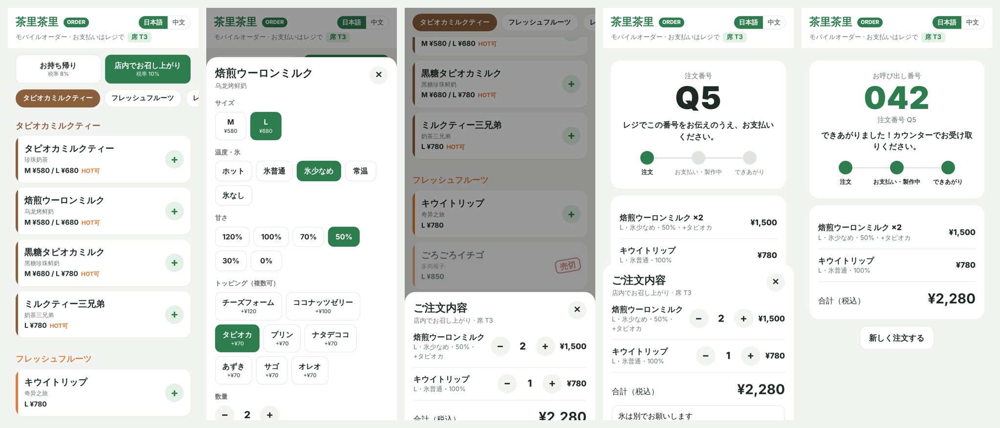

## 下一步

1. 带到店里给老板演示（文档里的 10 分钟方案），试点 10 单。
2. 确认文档里的 8 个问题（含税价、抽成、T 号、打印机型号等），把答案填进设置。
3. 第 1 期剩下的：订单同步到 Supabase（离线排队上传）、老板手机网页报表、钱箱。
4. 扫码点单加在线预付（Square / Stripe / PayPay）。
4. 第 2 期：楽天 App 联动或 Square Terminal API，收款不再手动输金额。
5. 第 3 期：菜单屏网页（同一份菜单数据实时显示售罄）。

## 项目结构

```
ChaliPOS/
├── ChaliPOS.swiftpm/        App 包（Swift Playgrounds / Xcode 直接打开）
│   ├── Package.swift
│   ├── App/                 入口、全局状态（AppStore）、顶部导航
│   ├── Model/               菜单、订单、计价和税、购物车、报表、标签、CSV、日结、本地存储（只依赖 Foundation）
│   ├── Order/               点单界面、规格弹层、购物车、结账
│   ├── Orders/              订单 / 制作队列
│   ├── SoldOut/             售罄管理
│   ├── Close/               日结
│   ├── Admin/               老板密码、报表、菜单编辑、导出、设置
│   ├── Print/               出杯标签、小票、AirPrint
│   ├── QROrder/             扫码单页面、二维码海报、Supabase 接口
│   └── UI/                  颜色和通用组件
├── QROrder/                 扫码点单：数据库 SQL、顾客手机页面、测试
└── CoreTests/               Model 层单元测试（Sources/ChaliCore 链接到 App 的 Model）
```

## 测试

```bash
cd ChaliPOS/CoreTests
swift test
```

19 个测试覆盖：菜单规则、价格和外卖价、内税计算、店内用换算、购物车合并 / 修改 / 加小料、营业日切换、报表汇总和常点组合、出杯标签、报税 CSV、日结现金差额、本地存储读写和旧文件兼容，
以及扫码点单：发布菜单的格式、解码数据库真实返回的订单、接单后收银金额和顾客看到的一致。扫码点单的数据库和顾客页面测试见 [QROrder/README.md](QROrder/README.md#测试)。

GitHub Actions（`.github/workflows/chalipos.yml`）会在 Linux 上跑这些测试，并在 macOS 上用 iOS SDK 检查、构建整个 App。

更新截图：在 Actions 页面手动运行 ChaliPOS（Run workflow），或在提交信息里写 `[screenshots]`。截图模式（启动参数 `-screenshot <页面>`）使用临时目录和示例订单，不会碰到真实数据，平时启动不生效。
