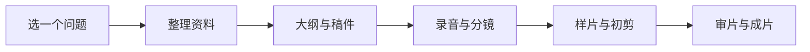

# 视频创作

选题、资料、稿件和制作进度，从这里接着做。

**现在的位置：工作流与资料入口已经整理；本期题目尚未正式选定。**

建议第一期先用已有《日本人身高》稿的一章做 3–5 分钟样片。它是待选择的建议；先确认采用哪版稿和哪一章，再开始录音与制作。

## 你只需要这样说

| 你想做什么 | 在 Codex 里说 |
|---|---|
| 恢复上次进度 | **继续制作，先告诉我当前最该做的一步。** |
| 放入新资料 | **把这些资料收到这个题目里，先帮我分清哪些有用。** |
| 记录灵感 | **记个选题：……** |
| 选一个题目 | **从选题台账里帮我选一个今天能推进的题目。** |
| 改稿 | **打开这一章，统计旁白字数和时长，帮我修改。** |
| 进入制作 | **这版稿可以了，整理录音和分镜的下一步。** |
| 暂时收工 | **保存当前进度，下次从这里继续。** |

日常不必每一步都新开对话。每期使用一个主要制作对话；新的一期再从「写稿」项目开始。当前「视频创作｜工作流与制作推进」保留总流程和这次参考片研究。

## 固定入口

| 入口 | 放什么 |
|---|---|
| [选题台账](/Users/wzz122/Desktop/写稿/选题/选题台账.md) | 想做的题、已有稿件、每日建议入口 |
| [资料收件箱](/Users/wzz122/Desktop/写稿/资料/00-收件箱/资料登记.md) | 还没归类的文件、链接、截图和录音 |
| [当前进度](/Users/wzz122/Desktop/写稿/制作/当前进度.md) | 当前版本、已做完什么、下一步 |
| [协作方式](/Users/wzz122/Desktop/写稿/工作流/协作方式.md) | 怎样分阶段推进、什么时候需要你判断 |
| [单期制作工作流](/Users/wzz122/Desktop/写稿/工作流/单期制作工作流.md) | 7 个阶段的负责人、产出、过关标准和工时；Claude 与 Codex 合议版（2026-09-29） |
| [单期制作模板](/Users/wzz122/Desktop/写稿/制作/单期模板.md) | 下一期的统一记录方式 |

## 从选题到成片

我负责把当前阶段的材料整理好、指出最影响进度的问题，并完成已授权的下一步。你主要决定选题与表达、确认重要改稿、录音和审片。

## 现有材料

- [日本人身高 · 完整版 v4](/Users/wzz122/Desktop/写稿/成稿/2026-09-21-日本人身高-完整版-v4.md)｜[证据卡 v4](/Users/wzz122/Desktop/写稿/资料/2026-09-日本人身高/完整稿-v4/证据卡-v4.md)。稿件存在不表示已批准制作。
- [名古屋亚运会 · 现有稿件](/Users/wzz122/Desktop/写稿/成稿/已生成/名古屋亚运会/2026-09-21-名古屋亚运会.md)｜[待核实事项](/Users/wzz122/Desktop/写稿/资料/2026-09-名古屋亚运会/待核实.md)。再次采用时先刷新时事资料。
- [两期参考视频的制作方案](/Users/wzz122/Documents/新媒体小红书写文章。/博主调研/09-两期整合分析与个人制作实施方案-2026-09-28.md)。
- [未来可视化工作台设计](/Users/wzz122/Documents/新媒体小红书写文章。/博主调研/10-视频制作工作台-软件选型与无额外API方案-2026-09-28.md)。这是设计方案，软件尚未开发。

资料与稿件继续保留在当前「写稿」项目，渲染由原有「视频工厂」执行，精修与输出使用达芬奇。本入口通过链接汇集已有文件，不复制一套容易分叉的资料。

更新：2026-09-28。
